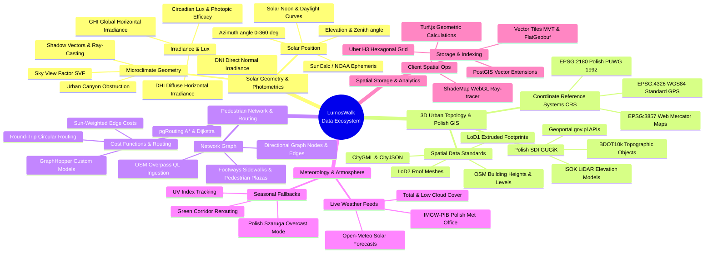
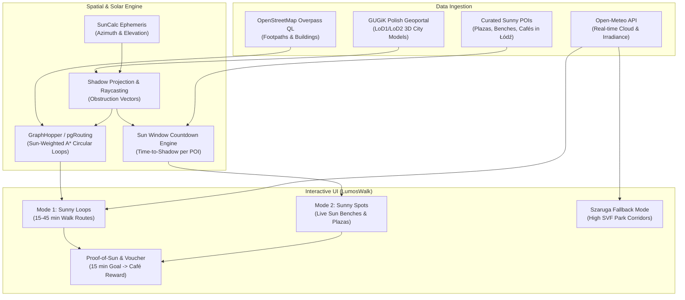

# LumosWalk: Data Architecture, Domain Keywords & Geospatial Mindmap

This document establishes the comprehensive data engineering foundation for **LumosWalk (Urban Microclimate & Mental Health Platform)**, tailored to Polish open geospatial datasets (GUGiK/Geoportal), atmospheric physics, and urban microclimates.

---

## 1. High-Level Data Ecosystem Mindmap

---

## 2. In-Depth Data Dictionary & Technical Keywords

### A. Solar Geometry & Photometric Physics
* **Solar Azimuth:** The compass direction from which sunlight comes (0° = North, 90° = East, 180° = South, 270° = West).
* **Solar Elevation (Altitude):** The angle between the center of the sun's disc and the ideal horizon. During Polish winters (December/January), peak solar elevation in Łódź reaches only **14°–16°** at solar noon, meaning even 3-story buildings cast shadows 3.5× to 4× their physical height.
* **SunCalc:** A widely utilized astronomical algorithm library (originating from Vladimir Agafonkin) computing solar coordinates, sunrise, sunset, golden hour, and nadir for any given timestamp and GPS coordinate.
* **Direct Normal Irradiance (DNI):** Amount of solar radiation received per unit area by a surface held perpendicular to the sun's rays. This directly powers the "Sun-Soaking" mental health benefit.
* **Diffuse Horizontal Irradiance (DHI):** Scattered daylight arriving equally from all parts of the sky hemisphere. Essential for the "Szaruga" mode when direct sun is obscured.
* **Sky View Factor (SVF):** Dimensionless parameter (0 to 1) describing the visible portion of the sky hemisphere from a street or bench. An SVF approaching 1.0 (parks, wide plazas) delivers maximum diffuse circadian lux on gray winter days.

---

### B. 3D Urban Topology & Polish Spatial Data (GUGiK)
* **GUGiK (Główny Urząd Geodezji i Kartografii):** Poland's central mapping agency responsible for nationwide open spatial data.
  * **Geoportal.gov.pl:** The primary discovery and download portal for open spatial data in Poland.
  * **BDOT10k (Baza Danych Obiektów Topograficznych):** High-precision vector database (1:10,000) containing building outlines, parks, footways, and land use across Poland.
  * **ISOK (Informatyczny System Osłony Kraju):** High-density LiDAR point clouds (classified LAS/LAZ format) and Digital Surface Models (DSM / NMT) covering Polish municipalities.
* **LoD (Level of Detail):**
  * **LoD1:** 2D building footprints extruded into flat-roofed 3D polygonal prisms using height or number of storeys.
  * **LoD2:** Buildings with differentiated roof shapes (pitched, mansard, flat), available as open data for major Polish cities (including Łódź).
* **Coordinate Reference System (CRS) Conversion:**
  * **EPSG:2180 (PUWG 1992):** Official Cartesian coordinate system for Polish national geographic data (measured in meters).
  * **EPSG:4326 (WGS84):** Ellipsoidal coordinates (latitude/longitude in decimal degrees), used by mobile GPS, OpenStreetMap, and GeoJSON.
  * **EPSG:3857 (Web Mercator):** Projected metric coordinate system used by web tile maps (Mapbox, MapLibre, Google Maps).
  * *Rule:* Never query spatial distances without reprojecting to a metric system (EPSG:2180 or local UTM 34N / EPSG:32634).

---

### C. Pedestrian Graphs & Dynamic Edge Weighting
* **OSM Overpass QL:** Query language to ingest pedestrian walkable topologies from OpenStreetMap (filtering for `highway~"footway|pedestrian|path|steps"` and `area:highway=pedestrian`).
* **Dynamic Sun-Weighted Cost Function:**
  $$C(e) = \text{Length}(e) \times \left(1 - w \cdot S(e, t)\right)$$
  * $e$: Road/sidewalk edge.
  * $S(e, t) \in [0, 1]$: Sunlight fraction on edge $e$ at timestamp $t$.
  * $w \in [0, 0.95]$: User preference slider prioritizing sunlight over pure walking distance.
* **Round-Trip / Circular Routing:** A graph traversal technique generating closed loops starting and ending at the origin (using radial via-points spaced at 120° angles or curvature penalties to prevent immediate backtracking).

---

### D. Atmospheric & Meteorological Fallback ("Szaruga")
* **Open-Meteo API:** High-resolution meteorological API offering 15-minute radiation data (`direct_normal_irradiance`, `diffuse_radiation`, `cloud_cover`, `uv_index`) with no API key requirement.
* **Szaruga Trigger:** In Polish meteorology, *szaruga* describes persistent low stratus clouds and drizzly winter gloom. When cloud cover exceeds 80%, the system switches objectives from shadow avoidance to **Sky View Factor maximization** (directing users to open parks and wide squares like Plac Wolności or Park Poniatowskiego).

---

### E. Spatial Data Storage & Pipeline Architecture
* **PostGIS:** Spatial database extension for PostgreSQL supporting 3D geometries, spatial indexing (GiST / BRIN), and ray-casting intersections (`ST_3DIntersects`).
* **H3 Spatial Index:** Hexagonal discrete global grid system developed by Uber. Ideal for discretizing city blocks into discrete cells (Resolution 9 $\approx$ 100m or Resolution 10 $\approx$ 35m) to store pre-computed shadow heatmaps.
* **Turf.js & MapLibre GL:** Client-side vector processing stack capable of 60 FPS real-time geometry rendering and interactive visual styling.

---

## 3. Data Pipeline Flow for LumosWalk

